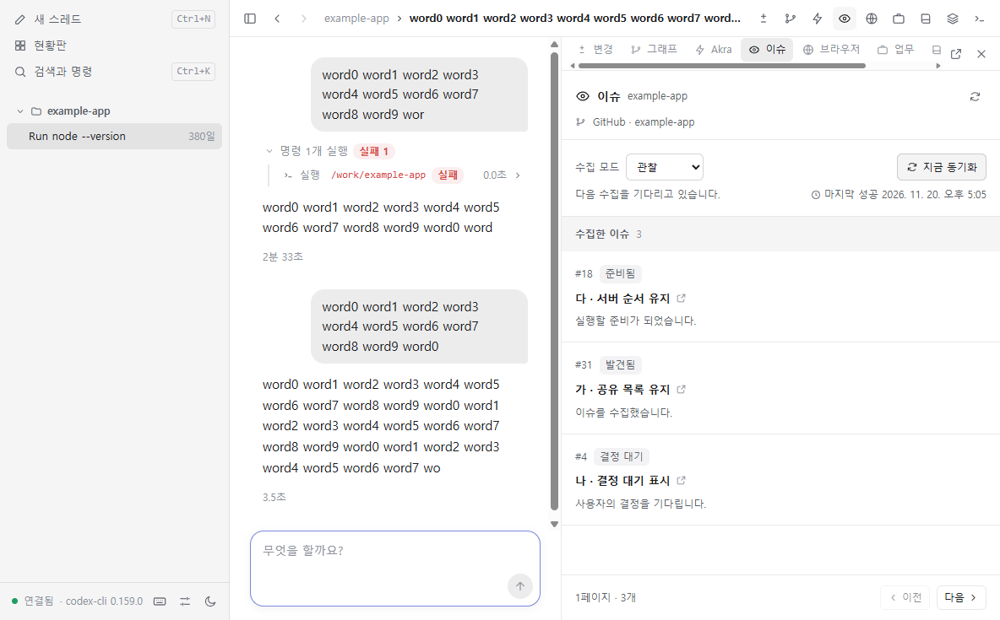
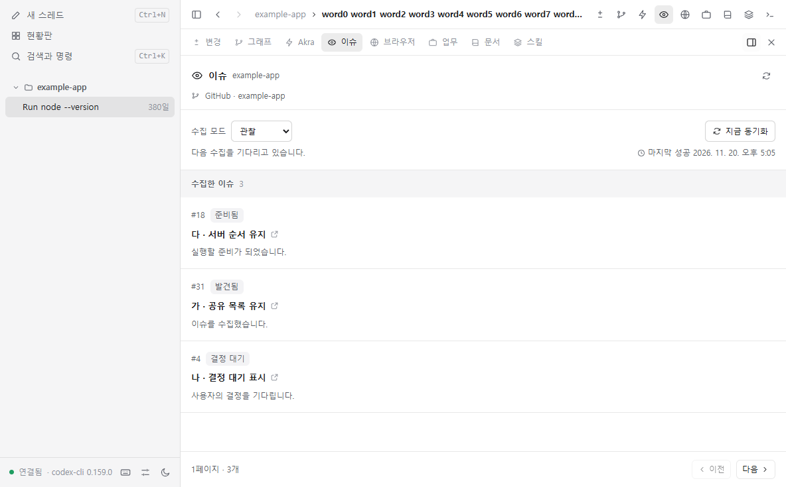

# Desktop 이슈 목록 검증 (#2539)

## 화면과 소유권

오른쪽 패널의 이슈 탭은 열린 대화의 작업 폴더가 속한 저장소를 보여 준다. 기존 업무 탭의 GitHub 보기는 그대로 별도 용도로 사용한다.

이슈 탭과 Akra 개요 탭은 DesktopSession의 같은 Gateway 연결과 KernelConnection을 사용한다. 관심 영역만 바뀌면 커널에 다시 붙지 않는다. 이슈 탭을 열 때는 issue_automation과 issues를 조회하며 planning 새로 고침 명령은 보내지 않는다. 두 탭이 모두 닫히면 기존 attach를 해제한다.

머리에는 연결된 공급자와 작업 폴더, 저장된 수집 모드, 수집 진행 상태, 마지막 성공 시각, 수집 오류를 표시한다. Off/Observe 변경과 지금 동기화는 공통 명령 sender를 통한다. 모드 변경에는 새 UUID 멱등 키를 붙이고, Read인 동기화에는 mutation key를 붙이지 않는다. 연결부의 진행 상태가 중복 클릭과 모드/동기화 동시 요청을 제한한다.

최대화는 오른쪽 패널이 작업 본문 영역을 채우는 동작이다. 복원하면 기존 패널 폭으로 돌아간다. 대화와 다른 옆 칸은 계속 장착된 상태로 숨기므로 내용을 잃지 않으며, 가려진 대화는 보이는 대화로 처리하지 않는다.

## 서버가 정한 표시 계약

목록 행은 items[].presentation의 번호, 제목, 상태 문구, 이유 문구를 그대로 표시한다. renderer는 원격 상태, workflow, flags로 상태나 그룹을 다시 판단하지 않는다.

IA1은 단일 collection 묶음을 사용한다. 서버는 groups의 순서와 item_indices의 행 순서를 지정한다. 화면은 이를 그대로 따른다. 안정 ID 기반 SQL 정렬과 기존 next_after cursor를 변경하지 않는다.

페이지는 한 번에 한 쪽을 표시한다. 이전 cursor 이력은 연결부가 소유한다. 이벤트의 issues는 수집 상태와 revision이고, query의 issues는 목록 페이지이므로 서로 대신 사용하지 않는다. 목록이 무효화되면 이전 제목을 숨기고 다시 조회한다. 다른 revision의 페이지는 섞지 않으며, 페이지 이동 중 revision이 바뀌면 첫 페이지부터 다시 읽는다.

workspace 변경, 재접속, 관심 영역 변경과 더 최신인 조회는 이전 요청을 무효화한다. 늦은 성공·오류·finally가 새 화면을 덮어쓰지 않는다. 구형 Gateway의 응답에 groups/presentation 계약이 없으면 명시적인 호환 오류를 표시하며 과거 snapshot으로 보충하지 않는다.

## 번호와 외부 링크

공급자의 현재 관찰에 선택적인 web 메타데이터를 저장한다. 신규 바이너리는 web이 없는 기존 JSON도 읽는다. 엄격한 JSON 검증을 유지하므로 구버전 바이너리가 새 필드를 읽는 역방향 호환은 보장하지 않는다.

GitHub adapter는 number, url, repository.nameWithOwner를 받고 현재 저장소 경로와 번호가 정확히 맞는 HTTPS 이슈 주소인지 검사한다. 번호는 표시용이며 장부 키, 중복 판단, 커서에 사용하지 않는다.

Shared는 현재 공유 제목과 web을 표시한다. Withheld는 현재 web만 제공한다. Unknown이나 아직 관찰하지 않은 기존 행에는 과거 제목·번호·링크를 채워 넣지 않는다. URL과 저장소 표시 이름 변경은 본문 해시에 포함하지 않는다.

제목을 누르면 기존 window.akra.github.openExternal 경로를 사용한다. main이 알려진 HTTPS 주소를 검사한 뒤 기본 브라우저를 연다. renderer가 URL을 조립하거나 공급자 API를 직접 호출하지 않는다.

## 검증 범위

- domain의 URL 검증과 기존 관찰 JSON 호환.
- GitHub discovery/resync의 번호·URL 전달, 저장소·번호 불일치와 악성 URL 거절.
- 실제 SQLite current_read의 새 metadata 저장/재조회와 변조된 metadata 거절.
- 기존 workflow 상태 보존, Shared/Withheld/Unknown/legacy 표시, 서버 group과 기존 cursor 경계.
- 연결부의 관심 영역·페이지 세대·늦은 응답·오류·재접속·중복 요청 회귀.
- 가짜 Gateway의 세 행을 서버 index 순서대로 표시하는 숨김 Electron 시험.
- 모드 명령 한 번과 UUID, Read 동기화, 성공 시각·오류·페이지 이동·재접속·detach.
- 허용 URL과 악성 URL에 대한 실제 main IPC 경계, 최대화와 복원.

기능 검증은 가짜 공급자와 가짜 Gateway를 사용한다. 모델 턴을 보내지 않으며, 화면 시험의 shell.openExternal은 기록용 stub으로 바꿔 실제 브라우저를 열지 않는다.

스크린샷과 최종 실행 결과는 PR 본문에 연결한다.

## 화면 증거

가짜 Gateway가 보낸 세 행은 index [2, 0, 1] 순서 그대로 표시한다. 번호나 제목으로 다시 정렬하지 않는다. 숨김 창에서 캡처했으며 실제 이슈 내용이나 사용자 대화는 포함하지 않았다.

### 일반 패널

### 최대화

최대화 중 대화를 선택하거나 뒤로·앞으로 이동하면 패널을 일반 너비로 복원한다. 가려진 대화를 읽은 것으로 처리하지 않도록 이 이동 경로도 회귀로 확인한다.
