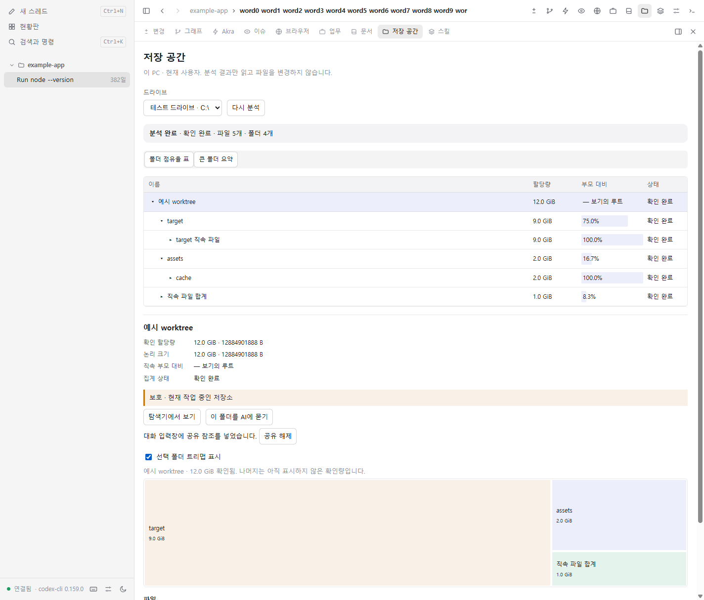

# 저장 공간 확장 검증 기록

검증일: 2026-11-23. Windows의 독립 worktree에서 실행했다. 검토용 화면은 개인정보가 없는 고정 fixture를 실제 Electron renderer로 렌더링하고 `webContents.capturePage()`로 캡처했다. 이미지의 12 GiB / 9 GiB 값은 화면 계약을 확인하기 위한 합성 값이다.

## 결과와 증거 수준

| 대상 | 실행 및 결과 | 검증 범위와 한계 |
| --- | --- | --- |
| Desktop 정적 검사·단위 검사·패키지·빌드 | `powershell -File scripts/check_native_pr.ps1 -Mode Admin` 통과. Desktop 67개 파일, 1,069개 테스트 통과. 기존 1개 파일 / 7개 테스트 skip 유지 | CI 정책, Node 계약, 의존성 audit, 게임 재현 빌드, Desktop TypeScript / Vitest / 번들까지 실제 실행했다. 공유 node_modules junction을 제거하고 독립 의존성을 설치한 상태다. |
| 기존 Desktop 전체 화면 회귀 | `npm run e2e` 종료 코드 0. 당시 27개 기본 시나리오 중 26개 성공, terminal 1개는 기존 Windows 기본 skip | 1차 구현 `f4dbcba9`에서 전체 실행했다. 블로그·스킬 lazy 패널, 커널, 이슈, 설정, 원격 호스트, vault 및 새 완료형 storage 화면을 포함한다. 실제 모델 서비스는 호출하지 않는다. |
| 선택 경로·숫자 최소 회귀 | `npm --prefix desktop run check`, `vitest run test/storageNavigation.test.ts test/storageNumbers.test.ts`, Desktop build 통과. 단위 2개 파일 / 8개 테스트 통과 | 추가한 선택 경로 4개 시험은 파일의 canonical 조상 경로와 tree 전용 상세 행, 합계·treemap 중복 제외, 접힌 선택의 roving tabindex, 늦은 응답과 잘못된 경로·revision 거절을 검증한다. 위 전체 Vitest 결과와 별도 실행이다. |
| 완료 결과·공유·근거 이동 | [storage-analysis.mjs](../../../desktop/test/e2e/storage-analysis.mjs) 통과 | 최종 입력 스키마에 없는 필드를 거절하는 fixture로 재검증한다. 명시 분석 1회, 닫기/재열기와 두 번째 클라이언트에서 추가 분석 없음, 12/9 GiB의 75.0%, 키보드 행 이동, 파일 Enter 선택 후 동일 tree 행 초점·부모 복귀, 접힌 중첩 요약·트리맵 선택의 조상 펼침과 roving tabindex, 파일 페이지·필터·재귀 조회, 미리보기 승인 후 입력창 삽입, 근거 행 초점, 연속 근거 클릭의 최신 요청 보존, 후속 갱신 중 필터 초점 유지, 늦은 응답 폐기, 패널 오류 격리·다시 열기, 외부 비활성화를 검증한다. |
| 진행 중 디렉터리·우선순위·취소 | [storage-live.mjs](../../../desktop/test/e2e/storage-live.mjs) 통과 | revision 0의 별도 metadata tree, 펼칠 때만 prioritize, queue full 표시, 닫기 중 늦은 응답, 동일 job 재열기, 취소 후 live 행 제거, 다음 명시 분석만 새 job 생성, 진행 목록의 공유 금지를 검증한다. 취소된 generic job의 result가 null이면 snapshot을 만들어내거나 조회하지 않는다. |
| 실제 scanner/index와 공통 호스트 연결 | `cargo test --locked --lib storage_`: 통합 작업에서 46개 통과, benchmark 1개 ignored. `composition::storage_extension::tests::storage_extension_real_scan_and_shared_read_use_one_registered_index` 포함 | 실제 fixture 디렉터리 2개 / 파일 2개, native 메타데이터와 실제 SQLite index를 사용한다. registry 입출력 스키마, 비활성 실행 거절, enable 시 scan 0회, 명시 scan, 같은 idempotency key 재조회, 원본과 공유 값 일치, 범위 밖 거절, 대화 epoch, revoke, disable 색인 정리를 검증했다. 이 시험의 호스트 state store는 MemoryStore이다. |
| durable host / 강제 종료 / 대용량 성능 | 위 Desktop 화면 및 native 연결 시험의 증거 범위 밖 | 실제 durable SQLite 호스트와 강제 종료는 K 계층의 별도 시험으로 판단한다. 이 문서는 fake UI 또는 작은 native fixture 결과를 전체 드라이브 성능 측정으로 표현하지 않는다. ignored benchmark는 실행 성공으로 계산하지 않는다. |

전체 E2E 이후 추가한 live UI와 strict query 정합성 변경은 Admin gate를 다시 통과했고, 두 storage 시나리오를 다시 실행했다. 기본 E2E 실행기는 폴더의 새 `.mjs`를 자동 수집하므로 이후 `npm run e2e`에는 `storage-live.mjs`까지 포함된다. `browserAutomation.mjs`와 `browserBridge.mjs`는 저장소의 기존 수동 시험 목록에 남아 있다.

## 화면 계약

- 확장을 켜거나 패널을 열 때에는 목록과 기존 작업만 읽는다. 분석은 분석 버튼에서만 접수하고 접수 키를 사용한다.
- repository attach와 local-user attach를 분리한다. 로컬 사용자 확장 상태와 실행 중 분석은 다른 창과 공유한다.
- 확정 snapshot의 바이트는 10진 문자열로 보존한다. 비율과 레이아웃 계산에는 BigInt를 사용하고 화면 좌표를 만들 때만 제한된 숫자 비율로 바꾼다.
- 부모가 12 GiB이고 자식이 9 GiB이면 표의 텍스트와 막대가 같은 75.0%를 사용한다. 페이지의 일부 항목을 전체로 재정규화하지 않고 나머지 확인량을 별도로 표시한다.
- 파일·요약·트리맵은 서버의 같은 node ID와 조상 경로로 표의 행을 펼치고 초점을 옮긴다. 선택 파일의 상세 행은 화면 경로에만 추가하며 집계 children이나 트리맵에 다시 더하지 않는다. 접혀 있는 선택에도 가장 가까운 표시 조상 행 하나를 Tab으로 찾을 수 있다.
- 공유는 선택이나 탐색으로 시작되지 않는다. 반환된 미리보기의 필드를 확인하고 승인한 뒤 기존 대화 입력창에만 참조를 넣는다. 전송은 사용자의 기존 입력창 동작으로 남긴다.
- `akra-storage:` 근거는 내부 동작이다. 서버 resolve 후 부모 경로와 행을 준비하고 현재 scope, snapshot revision, navigation revision, 사용자 상호작용이 모두 유지될 때만 선택과 초점을 옮긴다.
- pending 디렉터리는 확정 snapshot과 별도 모델이다. 바이트·비율·공유를 제공하지 않으며 완료된 결과만 기존 표로 전환한다.

## V3: fake Gateway 실행 중 Desktop 관측

원본: [desktop-fixture-metrics.json](desktop-fixture-metrics.json). Electron 45.2.3, Windows, 숨김 창, 발견 디렉터리 2개인 fake job에서 각 입력 직전에 진행 알림을 1회 보냈다. 기존 대화 입력창에 고정 문자열을 넣고 전송하지 않았다.

| 회차 | 자동화 fill 시작 → DOM 값 확인 | input 이벤트 → microtask DOM 확인 | input 이벤트 → 다음 프레임 |
| --- | --- | --- | --- |
| 1 | 7.02 ms | 0.00 ms | 996.60 ms |
| 2 | 5.23 ms | 0.00 ms | 988.50 ms |
| 3 | 4.49 ms | 0.00 ms | 982.00 ms |

자동화 경로는 Playwright 왕복 비용을 포함한다. microtask의 0 ms는 측정 타이머 정밀도에서의 결과이며 물리적인 키 입력 지연이 0이라는 뜻이 아니다. 숨김 창에서 다음 프레임은 약 1초 간격으로 관측되어 DOM 반영 시간과 분리했다. 이 수치로 보이는 창의 페인트 속도나 실제 native 스캔 부하의 입력 반응을 주장하지 않는다.

| 프로세스 | 샘플에서 관측한 프로세스 생애 최대 working set |
| --- | --- |
| Electron main | 125,928 KB |
| 주 renderer | 119,428 KB |

메모리는 [Electron MemoryInfo](https://www.electronjs.org/docs/latest/api/structures/memory-info)의 원본 KB 단위다. peak 값에는 시작 과정도 포함되며 GPU·utility·fake Gateway 시험 프로세스는 합산하지 않았다. 실제 scanner·SQLite·호스트의 peak working set과 대용량 페이지/필터 성능은 별도의 native 측정으로 판단한다.

## 검토 화면

### 완료 결과: 12 GiB / 9 GiB = 75.0%, 표와 트리맵



### 진행 중: 발견한 디렉터리와 집계 상태


## 재현

프로젝트 루트에서 의존성 설치 및 Admin 검사를 실행한다. Admin 검사는 Electron 실행 파일 다운로드를 생략하므로 화면 시험 전에는 해당 worktree의 Electron 설치 스크립트로 바이너리를 준비한다.

```powershell
powershell -File scripts/check_native_pr.ps1 -Mode Admin
Push-Location desktop
node node_modules/electron/install.js
node --experimental-strip-types --disable-warning=ExperimentalWarning --disable-warning=MODULE_TYPELESS_PACKAGE_JSON test/e2e/storage-analysis.mjs
node --experimental-strip-types --disable-warning=ExperimentalWarning --disable-warning=MODULE_TYPELESS_PACKAGE_JSON test/e2e/storage-live.mjs
Pop-Location
```

`AKRA_STORAGE_SCREENSHOT`에 출력 PNG 절대 경로를 지정하면 각 storage 시나리오에서 동일한 검토 화면을 저장한다. 캡처 유무는 기본 동작 검증에 영향을 주지 않는다. `AKRA_STORAGE_METRICS`에 출력 JSON 절대 경로를 지정하면 live 시나리오에서 동일한 입력·메모리 관측을 수행한다. 실제 native 통합 검증은 통합된 Rust 변경이 있는 branch에서 `cargo test --locked --lib storage_`로 실행한다.
