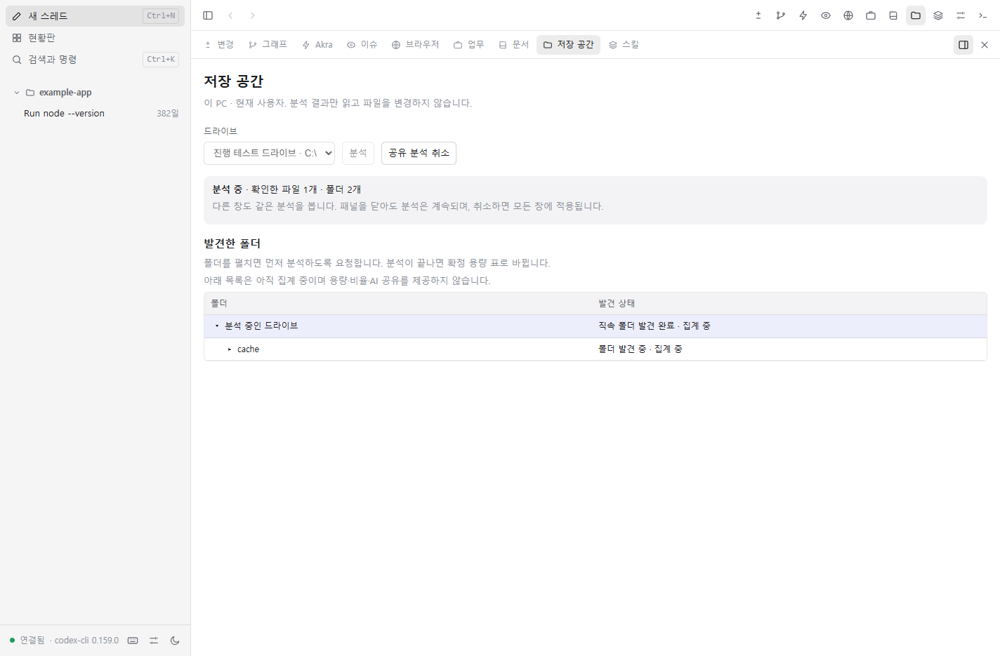

# 저장 공간 확장 검증 기록

검증일: 2026-11-23. Windows의 독립 worktree에서 실행했다.

최종 제품 소스는 `75db1f18c7c2b9e82a042975ea62b671502f5fa0`이다. 전체 기본 E2E는 `f0eae1ffdc641a6b231945aced3cf9b8f4bd2422`에서 완료했고, 후속 블로그 활동·알림·저장소 이동 통합의 영향 회귀와 Windows Full, 실제 SQLite 왕복은 최종 제품 소스에서 확인했다. 아래 표는 이 두 기준을 구분한다.

검토용 화면은 개인정보가 없는 고정 fixture를 실제 Electron renderer로 렌더링하고 `webContents.capturePage()`로 캡처했다. 이미지의 12 GiB / 9 GiB 값은 화면 계약을 확인하기 위한 합성 값이다.

## 결과와 증거 수준

| 대상 | 실행 및 결과 | 검증 범위와 한계 |
| --- | --- | --- |
| 최종 Windows Full | `75db1f18`에서 `powershell -File scripts/check_native_pr.ps1 -Mode Full`: 종료 코드 0. Desktop 69개 파일 / 1,082개 테스트 통과, 기존 1개 파일 / 7개 테스트 skip | CI 정책, Node/Admin 계약, 의존성 audit, 게임 재현 빌드, Desktop 타입·단위·번들, Windows native lib/bins check와 지정된 Windows 계약 필터, fmt·Clippy를 실행했다. 모든 Rust 단위 시험을 이 명령이 실행한 것으로 계산하지 않는다. 의존성은 worktree의 독립 설치를 사용했다. |
| Desktop 전체 기본 화면 회귀 | `f0eae1ff`에서 `npm --prefix desktop run e2e`: 종료 코드 0. 기본 30개 중 29개 성공, terminal 1개는 기존 Windows 기본 skip | 블로그·스킬 lazy 패널, 커널, 이슈, 설정, 원격 호스트, vault, 완료형·진행형·복원 storage와 확장 수명 사례를 포함한다. 후속 블로그 통합 후 이 전체 30개를 다시 실행한 것으로 표시하지 않는다. |
| 최종 소스 최소 단위 회귀 | `75db1f18`에서 check·build와 Vitest 5개 파일 / 21개 테스트 통과 | 블로그 단계, 확장 상태, storage 선택 경로·정수 비율, E2E 실행기 계약을 확인했다. canonical 조상 경로와 tree 전용 상세 행, 집계 중복 제외, roving tabindex, 늦거나 잘못된 경로·revision 거절을 포함한다. 위 Full의 전체 Vitest 실행과 구분한다. |
| 최신 블로그 활동·알림·저장소 이동 | `75db1f18`에서 [tech-blog.mjs](../../../desktop/test/e2e/tech-blog.mjs) 통과 | 패널을 닫아도 진행·미열람 결과를 유지한다. B 저장소에서 A 완료 알림의 실제 UI callback을 누르고 A attach를 지연해도 A의 정확한 글을 열며 B의 open/seen은 0회다. 렌더 중 pending 선택 소비를 커밋된 effect로 옮기고 활성 확인 전 패널 마운트를 막은 뒤 재현 실패가 성공으로 바뀌었다. 실제 preload를 통한 내보낸 글의 cwd/path 전달도 검사하며, VS Code 실행이나 운영 OS 알림 전달은 이 시험 범위가 아니다. |
| 완료 결과·공유·근거 이동 | `75db1f18`에서 [storage-analysis.mjs](../../../desktop/test/e2e/storage-analysis.mjs) 통과 | 최종 입력 스키마에 없는 필드를 거절하는 fixture로 재검증한다. 명시 분석 1회, 닫기/재열기와 두 번째 클라이언트에서 추가 분석 없음, 12/9 GiB의 75.0%, 키보드 행 이동, 파일 Enter 선택 후 동일 tree 행 초점·부모 복귀, 접힌 중첩 요약·트리맵 선택의 조상 펼침과 roving tabindex, 파일 페이지·필터·재귀 조회, G 보호 사유의 한국어 검토 필요 표시·본문/ignore 미검증·원본 근거 보존, 미리보기 승인 후 입력창 삽입, 근거 행 초점, 연속 근거 클릭의 최신 요청 보존, 후속 갱신 중 필터 초점 유지, 취소·만료로 현재 결과가 없을 때 옛 참조의 명시 오류와 자동 분석 없음, subpixel 타일의 비대화형 표시·resize 후 선택 유지·0/1 B 항목의 키보드 표 탐색, 늦은 응답 폐기, 패널 오류 격리·다시 열기, 외부 비활성화를 검증한다. |
| 확장 import·상태 변경 비동기 경합 | `75db1f18`에서 [extension-lifecycle.mjs](../../../desktop/test/e2e/extension-lifecycle.mjs) 7개 시나리오 통과 | 실제 Electron의 StoragePanel 모듈 요청을 실패·지연시켜 import 실패 격리·재시도, loading 중 닫기·disable 후 늦은 완료 무시를 검증한다. 기존 fake Gateway로 설정 저장 오류 응답, 두 창의 반대 configure·오래된 catalog/응답, disable 중 재연결의 최종 비활성 권위, 외부 cleanup 오류 사유와 범위 표시를 검증한다. production 시험 hook과 모델 호출은 추가하지 않았으며 실제 저장 장치 오류나 native durable store를 시험한 것은 아니다. |
| 진행 중 디렉터리·우선순위·취소 | `75db1f18`에서 [storage-live.mjs](../../../desktop/test/e2e/storage-live.mjs) 통과 | revision 0의 별도 metadata tree, 펼칠 때만 prioritize, queue full 표시, 닫기 중 늦은 응답, 동일 job 재열기, 취소 후 live 행 제거, 다음 명시 분석만 새 job 생성, 진행 목록의 공유 금지를 검증한다. 취소된 generic job의 result가 null이면 snapshot을 만들어내거나 조회하지 않는다. |
| 결과 복원·가상 집계 행 | `75db1f18`에서 [storage-restoration.mjs](../../../desktop/test/e2e/storage-restoration.mjs) 통과 | 완료 D 볼륨의 초기·교체 결과를 D로 복원하며 같은 결과의 갱신은 이후 사용자 선택을 덮지 않는다. snapshot/root 응답을 지연한 동안 분석·볼륨 선택을 막고, 사라진 드라이브를 C로 바꾸지 않는다. direct_files/shared_files는 자식 파일 목록처럼 표시하지 않고 집계 설명과 실제 소유 폴더 이동을 제공한다. |
| 실제 scanner/index와 공통 호스트 연결 | backend `3379ca69`에서 `cargo test --locked --lib storage_`: 75개 통과 / 2개 ignored, 확장 필터 50개 통과. [백엔드 검증 기록](../storage-analysis-backend.md) | native 메타데이터·실제 SQLite·등록 호스트의 시험이다. 원본/공유 일치, 범위·대화 epoch·revoke·disable 경합 등을 포함한다. 후속 블로그 통합에서 저장 공간 구현은 동일하다. Desktop fake 응답이나 아래 메타데이터 seed를 native 할당량의 독립 증명으로 계산하지 않는다. |
| 실제 공통 색인의 Desktop·CLI·근거 왕복 | `75db1f18`에서 `npm --prefix desktop run e2e:storage-service`: 통과했다(종료 코드 0). [원시 결과](service-roundtrip.json) | 하나의 실제 SQLite·읽기 서비스와 공통 registry를 Desktop과 실제 CLI 호출 어댑터가 함께 통과한다. 원시 snapshot/node ID·분자·분모, 75.0% 표시, 실제 서비스가 만든 근거의 키보드 행 초점까지 일치한다. 메타데이터 seed·MemoryStore·인증 fixture의 범위는 아래 V2 절에 명시했다. |
| durable host / 강제 종료 / 대용량 성능 | 위 Desktop 화면 및 native 연결 시험의 증거 범위 밖 | 실제 durable SQLite 호스트와 강제 종료는 K 계층의 별도 시험으로 판단한다. 이 문서는 fake UI 또는 작은 native fixture 결과를 전체 드라이브 성능 측정으로 표현하지 않는다. ignored benchmark는 실행 성공으로 계산하지 않는다. |

전체 30개 기본 E2E를 완료한 `f0eae1ff`와 최종 `75db1f18` 사이의 제품 변경은 블로그 활동·알림·읽음 처리와 공통 패널 연결이다. 저장 공간 UI·native adapter·공유 서비스의 diff가 없음을 확인하고, 최종 소스에서는 블로그와 공통 수명·storage 완료/진행/복원 5개 화면 사례를 다시 실행했다. 모든 화면 시험은 모델을 호출하지 않는다.

기본 실행기는 새 `.mjs`를 자동 수집한다. `browserAutomation.mjs`와 `browserBridge.mjs`는 기존 수동 목록에 남아 있고, Rust 읽기 서비스를 사용하는 `storage-service-roundtrip.mjs`는 전용 명령으로 따로 실행한다. 수동 사례를 기본 30개 성공 개수에 넣지 않는다.

## 화면 계약

- 확장을 켜거나 패널을 열 때에는 목록과 기존 작업만 읽는다. 분석은 분석 버튼에서만 접수하고 접수 키를 사용한다.
- repository attach와 local-user attach를 분리한다. 로컬 사용자 확장 상태와 실행 중 분석은 다른 창과 공유한다.
- 확정 snapshot의 바이트는 10진 문자열로 보존한다. 비율과 레이아웃 계산에는 BigInt를 사용하고 화면 좌표를 만들 때만 제한된 숫자 비율로 바꾼다.
- 부모가 12 GiB이고 자식이 9 GiB이면 표의 텍스트와 막대가 같은 75.0%를 사용한다. 페이지의 일부 항목을 전체로 재정규화하지 않고 나머지 확인량을 별도로 표시한다.
- 파일·요약·트리맵은 서버의 같은 node ID와 조상 경로로 표의 행을 펼치고 초점을 옮긴다. 선택 파일의 상세 행은 화면 경로에만 추가하며 집계 children이나 트리맵에 다시 더하지 않는다. 접혀 있는 선택에도 가장 가까운 표시 조상 행 하나를 Tab으로 찾을 수 있다. 트리맵의 실제 표시 크기가 1픽셀보다 작은 조각은 클릭·Tab 대상에서 제외하고 같은 노드의 표 탐색을 유지한다.
- 공유는 선택이나 탐색으로 시작되지 않는다. 반환된 미리보기의 필드를 확인하고 승인한 뒤 기존 대화 입력창에만 참조를 넣는다. 전송은 사용자의 기존 입력창 동작으로 남긴다.
- `akra-storage:` 근거는 내부 동작이다. 서버 resolve 후 부모 경로와 행을 준비하고 현재 scope, snapshot revision, navigation revision, 사용자 상호작용이 모두 유지될 때만 선택과 초점을 옮긴다.
- 기존 커널과 Git 인덱스의 관측 근거는 한국어 검토 사유로 표시한다. `untracked_observed`는 ignore 규칙을 적용한 Git 미추적 판정과 구분하고, `status_unknown`은 파일 본문·ignore 규칙을 읽지 않아 변경 없음이나 삭제 가능 여부를 판단할 수 없음을 명시한다. 한국어로 설명한 사유의 원본 detail과 관측 시점은 펼쳐 볼 수 있고, 알 수 없는 사유도 원문을 표시한다.
- direct_files/shared_files는 소유 폴더에 귀속된 가상 집계 행이다. 그룹 전용 파일·공유·탐색기 작업을 제시하지 않고 설명과 소유 폴더 이동을 제공한다. 소유 폴더에서는 일반 탐색과 명시 공유를 다시 사용할 수 있다.
- 복원 결과의 볼륨을 표시한 뒤 사용자가 다른 드라이브를 고르면 같은 결과의 후속 갱신으로 선택을 덮지 않는다. 새 완료 결과를 복원하는 동안 분석을 막고, 연결이 끊긴 드라이브도 다른 볼륨으로 자동 대체하지 않는다.
- pending 디렉터리는 확정 snapshot과 별도 모델이다. 바이트·비율·공유를 제공하지 않으며 완료된 결과만 기존 표로 전환한다.

## V2: 같은 SQLite 읽기 서비스의 Desktop·CLI 왕복

최종 제품 소스 `75db1f18`에서 `npm --prefix desktop run e2e:storage-service`를 Windows에서 실행해 통과했다(종료 코드 0). `AKRA_STORAGE_FIXTURE_BIN`을 지정하지 않아 Cargo artifact의 실제 자동 탐색 경로도 사용했다. 원시 결과는 [service-roundtrip.json](service-roundtrip.json)에 보존했다(기록 시각 `2026-11-23T06:35:12.749Z`). 이 사례는 위의 독립 화면 fixture와 다르게 하나의 실제 SQLite 색인과 등록된 확장 호스트를 두 어댑터가 함께 사용한다.

1. Rust의 `cfg(test)` helper가 빈 파일 3개와 디렉터리 3개를 native scanner로 열거한다. 외부에 읽기 서비스를 노출하기 전에 이 시험의 SQLite 행만 12/9/2/1 GiB 메타데이터로 설정한다. 12 GiB 파일을 만들거나 읽지 않는다.
2. 완료 job의 결과는 같은 색인의 snapshot이고, progress의 개수와 확인량도 같은 fixture와 일치한다. Desktop은 운영 코드의 Gateway 호출 어댑터로 catalog, jobs, snapshot, node, children을 읽고 75.0%를 렌더링한다.
3. 화면의 미리보기 승인으로 실제 공유 서비스가 grant와 CLI 명령 문구를 만든다. 시험은 반환된 문구 전체가 기존 대화 입력창에 들어오는지 확인하고 전송하지 않는다.
4. CLI 쪽은 운영 코드의 `verify_thread`와 `request_over_socket`을 사용해 initialize, 메타데이터 resume, attach, catalog 스키마 검사, shared 조회를 수행한다. `shared_get_node`, `shared_list_children`, `shared_find_hotspots`를 모두 같은 호스트·읽기 서비스로 전달한다.
5. Desktop 원본과 세 CLI 조회의 `snapshot_id`, `revision`, `node_id`, `allocated_bytes`, `numerator_bytes`, `denominator_bytes`를 원시 값으로 대조한다. 기록한 target은 `desktop-sqlite-fixture` / revision 1 / `n4`, 분자 9,663,676,416 B와 분모 12,884,901,888 B로 모두 일치했다. node ID는 native 열거 결과에서 얻으며 코드에 고정하지 않는다.
6. 공유 서비스가 반환한 실제 `akra-storage:` 참조를 합성 답변의 링크로 제시한다. 두 번째 Electron 창에서 클릭 전 루트 선택이 유지되고, Enter로 링크를 연 뒤 서버 resolve가 반환한 같은 노드가 선택되며 `tabindex=0`과 실제 키보드 초점을 갖는지 확인한다. 준비 후 scan과 모델 호출은 모두 0회다.

시험 전용 JSONL 계층은 확장 입력과 결과를 전달할 뿐 노드나 비율을 다시 만들지 않는다. SQLite seed, 테스트 호스트의 `MemoryStore`, 고정된 검증 대화 컨텍스트는 helper 내부에 한정되며 production 주입 API는 추가하지 않았다. 실제 Gateway의 인증·접속 수명 전체, CLI 최상위 인자 파서·기본 endpoint 선택·`request()` wrapper, durable 호스트 재시작·강제 종료는 이 시나리오의 증거 범위가 아니다. CLI 인자와 대화 바인딩, durable 복구는 각 계층의 별도 시험과 [K 검증 기록](../kernel-extension-host.md)으로 판단한다. 답변은 모델 없이 fixture가 제시하되, 그 안의 참조는 서비스가 실제 생성한 값이다.

### 전용 실행 명령

Rust 도구 체인과 Desktop 의존성·Electron 실행 파일을 준비한 뒤 저장소 루트에서 실행한다. 기본 `npm run e2e`는 Rust가 없는 Node/Admin 작업에서도 실행되므로 이 사례를 `scripts/e2e-specs.mjs`의 수동 목록에 이유와 함께 분리했다. Rust를 사용할 수 있는 Windows 또는 Linux 작업은 아래 전용 명령을 명시적으로 실행한다. 이번 기록에서 Linux 실행까지 확인한 것은 아니다.

```powershell
$env:AKRA_STORAGE_ROUNDTRIP_EVIDENCE = Join-Path (Get-Location) 'docs/validation/storage-analysis/service-roundtrip.json'
npm --prefix desktop run e2e:storage-service
```

```bash
AKRA_STORAGE_ROUNDTRIP_EVIDENCE="$PWD/docs/validation/storage-analysis/service-roundtrip.json" \
  CI=1 xvfb-run -a npm --prefix desktop run e2e:storage-service
```

[실행기](../../../desktop/scripts/run-storage-service-e2e.mjs)는 Desktop을 빌드한 뒤 `cargo test --locked --lib storage_desktop_fixture --no-run --message-format=json`의 `compiler-artifact.executable`을 사용한다. 운영체제별 확장자, target 경로, 실행 파일 해시를 가정하지 않는다. `CARGO_TARGET_DIR`와 선택적인 `CARGO` 실행 파일 설정을 그대로 존중한다. 별도로 빌드한 동일 소스의 라이브러리 시험 실행 파일은 `AKRA_STORAGE_FIXTURE_BIN`으로 지정할 수 있다. 직접 `.mjs`를 실행할 때 이 변수가 없으면 명시적으로 실패한다.

Rust helper는 [desktop_bridge.rs](../../../src/composition/storage_extension/tests/desktop_bridge.rs)의 `storage_desktop_fixture_bridge`와 [storage_desktop_fixture.rs](../../../src/adapter/outbound/extension_gateway_client/tests/storage_desktop_fixture.rs)의 `storage_desktop_fixture_cli`이다. 두 함수는 기본 Rust 단위 검사에서 ignored이며 전용 실행기가 환경을 설정해 각각 정확한 이름으로 실행한다. fixture가 만든 임시 디렉터리와 자체 프로세스만 정리한다.

## V3: fake Gateway 실행 중 Desktop 관측

원본: [desktop-fixture-metrics.json](desktop-fixture-metrics.json). 초기 live UI 구현에서 별도로 측정한 고정 fixture 결과이며 최종 제품 소스의 native 부하 측정으로 다시 표시하지 않는다. Electron 45.2.3, Windows, 숨김 창, 발견 디렉터리 2개인 fake job에서 각 입력 직전에 진행 알림을 1회 보냈다. 기존 대화 입력창에 고정 문자열을 넣고 전송하지 않았다.

| 회차 | 자동화 fill 시작 → DOM 값 확인 | input 이벤트 → microtask DOM 확인 | input 이벤트 → 다음 프레임 |
| --- | --- | --- | --- |
| 1 | 7.02 ms | 0.00 ms | 996.60 ms |
| 2 | 5.23 ms | 0.00 ms | 988.50 ms |
| 3 | 4.49 ms | 0.00 ms | 982.00 ms |

자동화 경로는 Playwright 왕복 비용을 포함한다. microtask의 0 ms는 측정 타이머 정밀도에서의 결과이며 물리적인 키 입력 지연이 0이라는 뜻이 아니다. 숨김 창에서 다음 프레임은 약 1초 간격으로 관측되어 DOM 반영 시간과 분리했다. 이 수치로 보이는 창의 페인트 속도나 실제 native 스캔 부하의 입력 반응을 주장하지 않는다.

| 프로세스 | 샘플에서 관측한 프로세스 생애 최대 working set |
| --- | --- |
| Electron main | 125,928 KB |
| 주 renderer | 119,428 KB |

메모리는 [Electron MemoryInfo](https://www.electronjs.org/docs/latest/api/structures/memory-info)의 원본 KB 단위다. peak 값에는 시작 과정도 포함되며 GPU·utility·fake Gateway 시험 프로세스는 합산하지 않았다. 실제 scanner·SQLite·호스트의 peak working set과 페이지/필터 성능은 [백엔드 native 측정](../storage-analysis-backend.md#5-v3-성능-측정-범위)으로 판단한다. 해당 원시 JSON은 측정 소스 `c690571b`와 21.18 MiB 관측값을 그대로 보존했다. 이 문서 갱신 과정에서 다시 측정하거나 값을 바꾸지 않았다.

## 검토 화면

두 이미지는 초기 구현 검증 때 저장한 고정 fixture 캡처다. 최종 소스에서 새로 촬영한 이미지로 표시하지 않는다.

### 완료 결과: 12 GiB / 9 GiB = 75.0%, 표와 트리맵


### 진행 중: 발견한 디렉터리와 집계 상태



## 재현

프로젝트 루트에서 최종 게이트는 Full 모드로 실행했다. Admin만 선택하면 Node/Desktop 범위이며 Windows native 계약·fmt·Clippy는 포함되지 않는다. 두 모드 모두 Electron 실행 파일 다운로드를 생략하므로 화면 시험 전에는 해당 worktree의 Electron 설치 스크립트로 바이너리를 준비한다.

```powershell
powershell -File scripts/check_native_pr.ps1 -Mode Full
Push-Location desktop
node node_modules/electron/install.js
node --experimental-strip-types --disable-warning=ExperimentalWarning --disable-warning=MODULE_TYPELESS_PACKAGE_JSON test/e2e/storage-analysis.mjs
node --experimental-strip-types --disable-warning=ExperimentalWarning --disable-warning=MODULE_TYPELESS_PACKAGE_JSON test/e2e/storage-live.mjs
node --experimental-strip-types --disable-warning=ExperimentalWarning --disable-warning=MODULE_TYPELESS_PACKAGE_JSON test/e2e/extension-lifecycle.mjs
node --experimental-strip-types --disable-warning=ExperimentalWarning --disable-warning=MODULE_TYPELESS_PACKAGE_JSON test/e2e/storage-restoration.mjs
node --experimental-strip-types --disable-warning=ExperimentalWarning --disable-warning=MODULE_TYPELESS_PACKAGE_JSON test/e2e/tech-blog.mjs
Pop-Location
npm --prefix desktop run e2e:storage-service
```

`AKRA_STORAGE_SCREENSHOT`에 출력 PNG 절대 경로를 지정하면 각 storage 시나리오에서 동일한 검토 화면을 저장한다. 캡처 유무는 기본 동작 검증에 영향을 주지 않는다. `AKRA_STORAGE_METRICS`에 출력 JSON 절대 경로를 지정하면 live 시나리오에서 동일한 입력·메모리 관측을 수행한다. 실제 native 통합 검증은 통합된 Rust 변경이 있는 branch에서 `cargo test --locked --lib storage_`로 실행한다.
